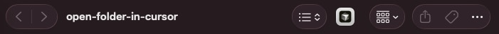

# Open in Zed

A Finder toolbar button to open the selected file or folder in Zed.



## Quick install

1. Run `./build-app.sh` to produce **Open in Zed.app**, then move it into your **Applications** folder.
2. Right-click the app and choose **Open** once to pass macOS Gatekeeper.
3. Hold **`Cmd`**, drag **Open in Zed.app** into the Finder toolbar.

## Step 1: Create the App via Automator

1. Open the **Automator** app on your Mac (press `Cmd + Space` and type "Automator").
2. Click **New Document** and select **Application**.
3. In the left-hand search bar, search for **"Run AppleScript"** and drag it into the empty workflow area on the right.
4. Delete any default text in the script box and paste the following AppleScript:

```
on run {input, parameters}
    tell application "Finder"
        if selection is {} then
            set finderSelection to folder of the front window as alias
        else
            set finderSelection to selection as alias list
        end if
    end tell

    openInZed(finderSelection)
    return input
end run

on open (theList)
    openInZed(theList)
end open

on openInZed(listOfAliases)
    tell application "Zed"
        activate
        open listOfAliases
    end tell
end openInZed
```

5. Go to **File > Save**, name it **"Open in Zed"**, and save it directly into your **Applications** folder.

## Step 2: Give it the Zed Icon (Optional)

If you want the button to have the distinct Zed logo rather than the default Automator robot icon:

1. Find **Zed.app** in your Applications folder, right-click it, and choose **Get Info**.
2. Click the small Zed icon at the very top-left of the info window so it highlights in blue, and press `Cmd + C` to copy it.
3. Right-click your new **Open in Zed.app**, choose **Get Info**, click its top-left icon, and press `Cmd + V` to paste.

## Step 3: Add it to your Finder Toolbar

1. Navigate to your **Applications** folder in Finder.
2. Hold down the **`Cmd`** key, then click and drag your **Open in Zed.app** straight up into the Finder toolbar.

The first time you click it, macOS will ask for permission to let the script control Finder and Zed. Click **OK**, and it will function seamlessly from then on.
